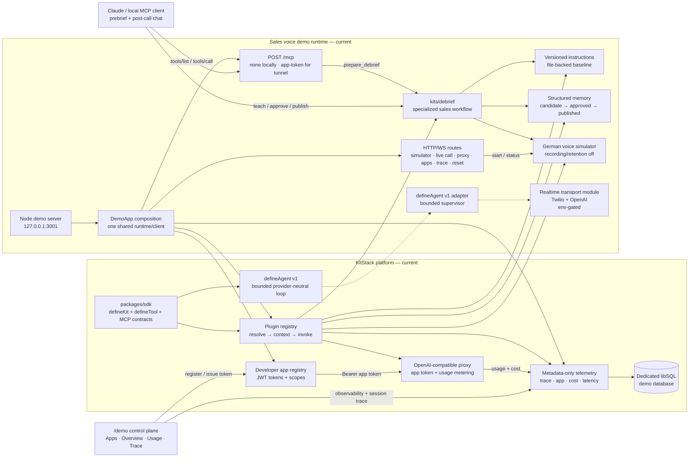
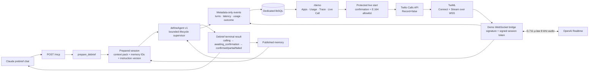
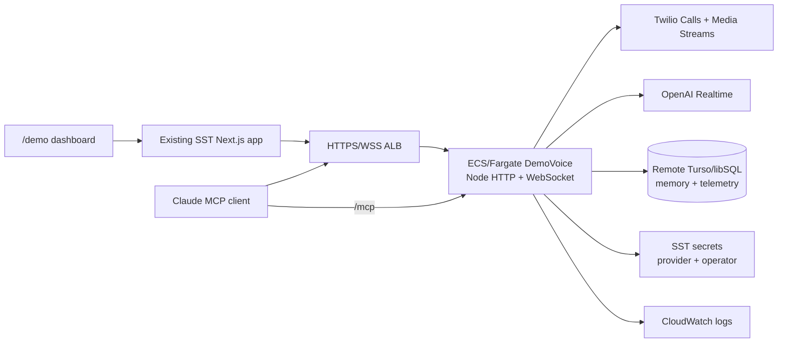

# KitStack sales voice agent architecture

This document has two views because the repository is between an implemented
local demo and a real-phone target:

- **Current status:** the simulator, debrief workflow, plugins, memory,
  instructions, telemetry, proxy, app registry, MCP/stdio paths, `/demo`
  dashboards, protected live-start route, and WebSocket upgrade are composed
  and locally verified with fake providers. The AWS deployment seam is also
  implemented: the demo image and single-task Fargate/ALB service compile and
  build locally, but no AWS account deployment or credentialed phone smoke has
  passed.
- **Target after the external T-0165 smoke:** the same prepared session can
  select a protected, allowlisted Twilio/OpenAI Realtime call, with
  `defineAgent v1` supervising the bounded lifecycle and the dashboards
  showing the shared trace.

The target is an unreleased demo that can run locally or as a single-task AWS
service. It is not a production deployment and must use synthetic account
data.

## Current implementation view

Solid paths below are implemented/local-tested. Dashed paths are optional
provider seams or the external T-0165 smoke still requiring credentials.

## Target integration view — T-0165 external smoke

This is the intended real-phone call sequence. Its local composition and
fake-provider checks are complete; the remaining T-0165 work is a
credentialed, allowlisted provider/tunnel smoke.

## AWS deployment view — T-0166 implementation complete

The existing KitStack web/MCP stack remains on SST-managed Lambda resources.
The voice demo is deployed beside it because the Twilio media stream and
OpenAI Realtime connection are long-lived outbound WebSockets.

The first deployment is pinned to one task so the demo's in-process session,
app registry, and debrief lifecycle remain coherent across the prebrief and
phone call. The database is remote so telemetry and memory survive container
replacement. Real phone calls additionally require a Route 53 domain with
HTTPS/WSS and the T-0167 operator setup.

## `defineAgent` boundary

`defineAgent v1` owns one run's session isolation, bounded turn source,
model/output seam, declared tools, instruction version, max-turn and
wall-clock limits, cancellation, and metadata-only lifecycle hooks. The
Realtime adapter creates one bounded supervisor per prepared session and feeds
it content-free provider events such as turn completion, interruption, stop,
and error.

OpenAI Realtime still owns the low-latency audio transport and speech-response
generation in this v1 composition. The current SDK contract is text-turn
shaped; it does not directly own every audio frame or Realtime function-call
event. Therefore this implementation is honestly a bounded lifecycle
supervisor around a provider-owned realtime connector, not a stream-native
agent loop with direct tool orchestration. A stronger claim requires a future
stream-native SDK connector and corresponding tests.

The privacy boundary is deliberate in both views: no audio, transcript,
prompt, completion, or tool payload is written to KitStack telemetry. Only
identifiers, instruction/memory references, lifecycle outcomes, latency, and
provider usage metadata are eligible for persistence.

## Target demo sequence

1. Chat prebrief calls `prepare_debrief`, resolving instructions and published
   memory for one session.
2. The presenter uses the simulator by default; once provider credentials and
   a public tunnel are configured, the presenter may explicitly confirm the
   allowlisted number and start the live call.
3. The voice path records only metadata and transitions the same session
   through the debrief state machine.
4. Claude retrieves/confirms the result and teaches a correction.
5. Approval/publication makes the structured memory available to the second
   run.
6. `/demo` shows app registration/token issuance, per-app cost and latency,
   provider/status, instruction and memory references, and the session trace.

The simulator is the working local demo until the T-0165 credentialed phone
gate passes. The live provider is not represented as verified merely because
its isolated transport tests pass.
