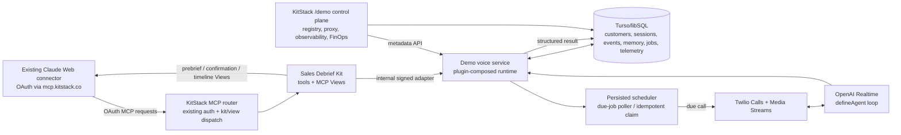

# Sales Voice Agent Demo — Target Flow and Execution Plan

**Status:** implementation complete through deployed rehearsal gate; live provider rehearsal pending  
**Date:** 16 September 2026  
**Scope:** presenter-ready sales voice workflow plus two small developer proof surfaces  
**Deployment assumption:** production stage is deployed; no production teardown or redeploy is part of this planning pass.

## 1. Product definition

The demo is a single customer workflow that crosses Claude chat, KitStack MCP
Views, a scheduled phone call, and KitStack developer observability.

The presenter writes in the existing Claude thread:

> Use the debrief kit. I am meeting a client in two minutes. Call me back at
> 22:05. The client is Acme Corp, contact Mr John Doe, location Köln Café.

The debrief kit must then:

1. identify or create the customer/contact context;
2. retrieve the most relevant prior customer events and approved memories;
3. return a compact, consumable prebrief View;
4. create one persisted debrief session;
5. schedule the outbound call for the requested time plus the explicit demo
   buffer rule;
6. wait without requiring the presenter to click a second “start call” button;
7. place the Twilio/OpenAI Realtime call against the same session;
8. let the presenter provide updates and a new client address during the call;
9. allow Claude to request “give me the debrief for confirmation”;
10. render an editable confirmation View;
11. save the confirmed structured customer events; and
12. show those new events in the customer timeline and developer dashboards.

The proof is not a generic voice bot. It is the continuity of one customer
session across prebrief, scheduler, phone call, confirmation, memory, and
observability.

## 2. Current status: what exists today

### Working and reusable

- `packages/demo` is a working single-process sales demo runtime.
- The demo has plugin registration and runtime dispatch for persistence,
  memory, instructions, debrief kit, AI, HTTP, trigger, voice channel, and
  proxy capabilities.
- The SDK has `defineAgent v1`; the Twilio/OpenAI Realtime bridge exists and
  uses the bounded agent loop.
- The simulator path runs the two-pass feedback loop:
  prebrief → call → partial result → teach/approve/publish → second prebrief.
- Memory and metadata-only telemetry persist through libSQL/Turso.
- The OpenAI-compatible proxy records app identity, token usage, latency, and
  estimated cost.
- `/demo` already exposes Apps, Overview, Plugins, Usage, and Session Trace.
- The production deployment has a dedicated voice service at the configured
  voice domain and the existing platform MCP service remains at
  `mcp.kitstack.co`.
- `kits/debrief` is now a self-contained package boundary and can define tools,
  triggers, channels, policies, and host capability contracts.
- The SDK already supports MCP Apps Views with loaders and sandboxed React
  components; existing kits demonstrate this pattern.

### Partial or wrong for the target flow

- The existing Claude connector now reaches the virtual debrief kit through
  `mcp.kitstack.co` OAuth; the router-to-voice hop is internal-signed.
- Rich `prepare_debrief` accepts customer identity, callback time/timezone, and
  buffer; it persists customer/session/event/job state and returns the prebrief.
- Session, customer, draft, event, memory, scheduler, and metadata-only
  telemetry persistence are implemented through the plugin-composed runtime.
- The persisted scheduler invokes the Twilio/OpenAI Realtime `defineAgent`
  path when a due job is claimed; live provider completion is still pending a
  deliberate operator phone rehearsal.
- `kits/debrief` exposes eight tools and three production MCP Views: prebrief,
  editable confirmation, and customer timeline.
- `/demo` exposes Runtime/Registry plus Usage/Observability/FinOps proof
  surfaces over the same session, customer, trace, provider, and cost data.
- The deployment image includes `kits/debrief`; legacy telemetry and memory
  schemas migrate customer columns before creating their indexes.

### Deliberate non-goals for this demo

- No general-purpose calendar integration.
- No CRM vendor integration; customer history is synthetic and local to the
  demo organization.
- No transcript or audio persistence.
- No unrestricted outbound calling; the destination remains one allowlisted
  operator number.
- No model-weight reinforcement learning. “Learning” remains structured
  correction → approved memory → next-run retrieval.
- No generalized distributed scheduler or production job platform in this
  slice.
- No full FinOps product. We need a credible developer proof of cost and
  usage, not billing reconciliation.

## 3. Target architecture



### Architectural decision

`mcp.kitstack.co` remains the presenter-facing MCP origin because it already
has the Claude OAuth connection. The existing router gains a narrowly scoped
sales-debrief adapter. The dedicated voice service remains the provider and
scheduler runtime; it is not replaced by the existing MCP Lambda.

The adapter must pass the authenticated KitStack user identity and a signed
internal request context to the voice service. The voice service must not trust
arbitrary public caller-supplied org/user IDs.

The current direct demo `/mcp` endpoint remains a local/fallback test surface,
but it is not the target presenter path.

## 4. Workstreams and tickets

Ticket IDs below are proposed follow-ons to T-0183. Each ticket has a bounded
write scope and a testable acceptance gate. Agents should not modify adjacent
workstreams without PM integration approval.

### W0 — Freeze the presenter contract and test fixture

#### T-0184 — presenter contract and deterministic clock fixture

**Goal:** freeze the request/response contract before implementation forks.

**Scope:**

- Define the expanded `prepare_debrief` input:
  `goal`, `company`, `contact_name`, `location`, `callback_at`,
  `callback_timezone`, and optional `buffer_minutes`.
- Define the normalized output:
  `session_id`, `customer_id`, `prebrief`, `scheduled_call_at`,
  `destination_masked`, and View metadata.
- Define `customer_event` types: `prebrief`, `call_completed`, `note`,
  `address_discovered`, `debrief_confirmed`.
- Define the confirmation draft and immutable event shape.
- Add a fake clock and a deterministic scheduler test harness.

**Acceptance:** the contract test describes the complete presenter sequence;
all later tickets consume the same types; ambiguous timestamps fail with an
actionable validation error.

**Dependency:** none.  **Write scope:** `kits/debrief/src/contracts.ts`,
demo contract tests, shared fixture files.

### W1 — Reuse the existing Claude connector

#### T-0185 — existing MCP router sales-debrief adapter

**Goal:** make the already-connected Claude Web connector invoke the sales
debrief kit through `mcp.kitstack.co`.

**Scope:**

- Add a special platform adapter for the debrief kit in the existing MCP
  router, without changing existing kit behavior.
- Forward authenticated user identity, kit identity, request ID, and trace ID
  to the voice service through a signed internal request.
- Route debrief tool calls and View loader calls to the demo service.
- Preserve the existing OAuth discovery and access-token behavior.
- Keep the direct voice-service `/mcp` route available for local tests only.
- Add explicit timeout/error mapping so an unavailable voice service produces a
  useful MCP error instead of a generic Lambda failure.

**Acceptance:** the already-connected Claude connector can discover the
debrief tools and call `prepare_debrief`; existing kits and OAuth tests remain
green; no app-token copy/paste is required for the presenter path.

**Dependencies:** T-0184.  **Write scope:** `packages/mcp-server/src/router`
adapter/dispatch files, `infra/mcp.ts`, integration tests.

### W2 — Customer and debrief persistence

#### T-0186 — customer context, event ledger, and durable sessions

**Goal:** replace the current goal-only/in-memory session model with a small
customer-specific persistence layer.

**Scope:**

- Add libSQL tables for `demo_customers`, `demo_customer_events`,
  `demo_debrief_sessions`, and `demo_debrief_drafts`.
- Normalize company/contact/location and match an existing customer by stable
  organization-scoped identity.
- Persist session state, callback time, call ID, instruction version, memory
  references, and draft fields.
- Store structured facts and operator notes only; never store transcript/audio.
- Make reads customer-scoped and organization-scoped.
- Keep the existing memory tables and connect approved memories to the
  customer/session context.

**Acceptance:** a process restart can reload a prepared session and its
  customer context; a second prebrief retrieves the latest approved customer
  events and memories; isolation tests prevent cross-customer/org reads.

**Dependencies:** T-0184.  **Write scope:** `packages/demo/src/memory`,
`packages/demo/src/debrief`, persistence schema/migrations, tests.

#### T-0187 — structured prebrief generation

**Goal:** return a useful prebrief immediately after the Claude request.

**Scope:**

- Expand `prepare_debrief` to upsert customer/contact context.
- Retrieve latest customer events, prior debrief outcomes, and approved
  memories.
- Produce a concise summary with “known”, “last interaction”, “open items”,
  and “call objective” sections.
- Return a stable session ID and scheduling plan.
- Emit metadata-only events linking the prebrief to customer/session IDs.

**Acceptance:** Acme Corp with no history returns an honest empty-history
  state; a subsequent run shows the previous confirmed event and memory; the
  LLM-facing response is short enough to consume without opening the View.

**Dependencies:** T-0186.  **Write scope:** demo debrief orchestration and
  kit tool adapter.

### W3 — Scheduler and automatic call start

#### T-0188 — persisted scheduled-call plugin

**Goal:** schedule and automatically initiate the call without a dashboard
  click.

**Scope:**

- Add a `scheduled_calls` table with `scheduled_at`, `status`, `session_id`,
  attempt count, lease/claim fields, and provider call ID.
- Add a scheduler plugin with `schedule`, `claim_due`, `complete`, and `fail`
  operations.
- Run a single-task poller in the voice service; on restart it resumes due
  jobs from libSQL.
- Make claiming idempotent so a call is not placed twice.
- Record the schedule, claim, provider start, and failure in telemetry.
- Keep a later EventBridge replacement out of scope.

**Acceptance:** a fake-clock test schedules a call, advances time, claims it
  once, and invokes the Twilio seam; restart/retry does not duplicate the call;
  a failed provider call becomes visible in the session state.

**Dependencies:** T-0186, T-0184.  **Write scope:** scheduler plugin/service,
  schema, worker tests.

#### T-0189 — live call binding to scheduled sessions

**Goal:** make the existing `defineAgent`/Twilio path consume scheduled jobs.

**Scope:**

- Move the current live-call preparation logic behind the scheduler claim.
- Resolve instructions and customer context from the persisted session.
- Bind the call to the session/customer/job IDs.
- Preserve E.164 allowlisting, Twilio signature validation, signed stream
  tokens, recording disabled, and provider-retention constraints.
- Add provider status callbacks or a polling seam sufficient to distinguish
  ringing, connected, completed, and failed for the dashboard.

**Acceptance:** a scheduled job places exactly one allowlisted call; the
  existing live provider tests remain green; the call status is visible without
  manual start; a fake provider completes the same lifecycle deterministically.

**Dependencies:** T-0188.  **Write scope:** `packages/demo/src/server.ts`,
  realtime/voice bridge, scheduler integration tests.

### W4 — MCP Views inside Claude

#### T-0190 — prebrief View

**Goal:** make the prebrief visually consumable during the presenter’s waiting
  window.

**Scope:**

- Add a `prebrief` View to `kits/debrief`.
- Show customer, contact, location, last interaction, relevant history,
  objective, call time/countdown, and privacy/provider status.
- Add a loader contract keyed by session/customer ID.
- Make `prepare_debrief` return the View metadata in the MCP-compatible kit
  path.

**Acceptance:** Claude renders the prebrief View after one tool call; empty
  history is explicit; the View has no raw transcript/audio or unmasked phone
  number.

**Dependencies:** T-0185, T-0187.  **Write scope:** `kits/debrief/src/views`,
  kit config, loader/view tests, registry view metadata.

#### T-0191 — editable confirmation View and mutation tools

**Goal:** let the presenter confirm structured outcomes in the original Claude
  thread.

**Scope:**

- Add `get_debrief_for_confirmation` or extend `get_debrief` to return a
  confirmation View.
- Add tools for updating draft fields, confirming the draft, and marking it
  partial.
- Support the demo fields: outcome, next step, customer update, discovered
  address, and follow-up date.
- Use `useTool`/`callTool` from the MCP View bridge; invalidate/reload after a
  mutation.
- Save immutable customer events only on explicit confirmation.

**Acceptance:** the presenter says “give me the debrief for confirmation”,
  edits the address/next step, confirms, and sees a saved event ID; cancel or
  partial leaves no confirmed event; duplicate confirmation is idempotent.

**Dependencies:** T-0186, T-0190.  **Write scope:** debrief tools/contracts,
  confirmation View, mutation tests.

#### T-0192 — customer timeline View

**Goal:** show the customer’s latest events after confirmation.

**Scope:**

- Add a `customer-timeline` View with newest-first events and event type
  badges.
- Include the newly confirmed call outcome and discovered address.
- Link the timeline to the active customer/session, not global demo events.
- Keep provider/cost metadata summarized and transcript-free.

**Acceptance:** after confirmation, Claude can render the timeline and the new
  event is visible; a second customer does not see Acme Corp’s events.

**Dependencies:** T-0186, T-0191.  **Write scope:** timeline View/loader and
  customer event tests.

### W5 — Developer proof surfaces

#### T-0193 — consolidate `/demo` into two presenter-facing dashboard screens

**Goal:** prove KitStack’s platform value without building a second product
  dashboard.

**Screen A — Runtime / Registry:**

- registered kits/plugins and versions;
- active scheduler jobs and call status;
- current customer/session/kit linkage;
- provider health and recent failures.

**Screen B — Usage / Observability / FinOps:**

- filter by app, kit, plugin, customer, session, and time;
- proxy requests, token usage, latency, estimated cost, and model/provider;
- per-app and per-session cost rollups;
- memory/instruction references;
- trace tree from prebrief through scheduled call through confirmation;
- no prompt, transcript, audio, or secret display.

**Acceptance:** one refreshable dashboard proves registry, proxy, observability,
and FinOps in the same metadata model; the presenter can select Acme Corp and
see the complete trace; existing Apps/Plugins/Usage/Trace behavior remains
available.

**Dependencies:** T-0188, T-0189, T-0191.  **Write scope:** `web/src/app/demo`,
  demo observability API, dashboard tests.

### W6 — Deploy and rehearsal gate

#### T-0194 — production demo rehearsal and rollback-safe release

**Goal:** prove the exact presenter sequence against the deployed service.

**Scope:**

- Deploy the MCP adapter and voice-service changes in the production stage.
- Verify existing `mcp.kitstack.co` OAuth still works for existing kits.
- Verify the debrief kit tool list and all three Views.
- Run the exact Acme Corp flow with a controlled operator number.
- Capture screenshots/notes for the demo script.
- Keep a rollback path to the last known-good commits.

**Acceptance:**

1. Existing Claude connector invokes the debrief kit.
2. Prebrief View appears within the chat.
3. Scheduler waits for the configured time/buffer.
4. Phone rings without a dashboard start click.
5. Agent conversation completes and returns to the same session.
6. Editable confirmation View saves the confirmed outcome/address.
7. Customer timeline View shows the new event.
8. Registry/observability/FinOps dashboard shows the same run.
9. A second run retrieves the first run’s approved memory.
10. Existing KitStack connector/kit smoke tests remain green.

**Dependencies:** T-0185 through T-0193.  **Write scope:** deployment config,
  rehearsal artifacts, no new runtime architecture.

## 5. Execution order and timebox

### Live execution status (2026-09-15)

| Ticket | Status | Checkpoint |
|---|---|---|
| T-0184 | done | `fc04b2d`; contract, timezone validation, fake clock, and presenter sequence tests pass |
| T-0185 | done | `974ec1b`; virtual kit, signed internal bridge, and unavailable-service mapping pass focused tests |
| T-0186 | done | `794dd0d`; durable customer/event/session/draft tables and isolation/restart tests pass |
| T-0187 | done | rich customer prebrief, proxy/AI telemetry, schedule/view metadata, and two-run retrieval pass |
| T-0188 | done | persisted scheduler plugin, lease/idempotency/restart semantics, poller seam, and fake-clock tests pass |
| T-0189 | done | persisted scheduler → allowlisted Twilio/defineAgent call, callbacks, completion draft, and internal-signed production mode pass focused tests |
| T-0190 | done | prebrief View/config/loader and virtual metadata in `5411f46`; shell resolution/build in `e0db59c` |
| T-0191 | done | editable confirmation tools/View, idempotent event writes, tests in `7fa57bb` |
| T-0192 | done | customer timeline View, privacy-safe event projection, host plumbing, isolation tests in `ff68a30` |
| T-0193 | done | Runtime/Registry and Usage/Observability/FinOps screens plus metadata filters/rollups in `ff68a30` |
| T-0194 | in_progress | production deployed; OAuth/router smoke, all three View shells/loaders, `internal-signed` voice rollout, and legacy DB migration pass; live scheduled Twilio/OpenAI call, confirmation/timeline, second-run memory, and rollback evidence remain |
| T-0195 | done | repeatable debrief View build/publish path and router shell resolution in `e0db59c` |

The four generated `sst-env.d.ts` files and `.dockerignore` remain intentionally
unstaged deployment artifacts from the prior production checkpoint.

The critical path is:

```text
T-0184
  → T-0185 + T-0186
  → T-0187
  → T-0188
  → T-0189
  → T-0190 + T-0191 + T-0192
  → T-0195 (View shell publishing; can begin after T-0184 and completes with T-0190)
  → T-0193
  → T-0194
```

Suggested eight-hour implementation allocation:

| Time | Work | Output |
|---|---|---|
| 0:00–0:30 | T-0184 | frozen contracts, fixtures, timestamp decision |
| 0:30–1:45 | T-0185 | existing connector reaches debrief adapter |
| 1:45–3:00 | T-0186/T-0187 | customer records and rich prebrief |
| 3:00–4:15 | T-0188 | persisted scheduler and fake-clock gate |
| 4:15–5:15 | T-0189 | automatic live-call binding |
| 5:15–6:45 | T-0190/T-0191/T-0192 | three MCP Views and confirmation writes |
| 6:45–7:30 | T-0193 | two dashboard screens/filters |
| 7:30–8:00 | T-0194 | deployed rehearsal and rollback checkpoint |

If the existing MCP adapter proves larger than expected, keep the direct demo
endpoint as a temporary presenter fallback and finish the local end-to-end
flow first. Do not silently replace the existing connector or skip the Views.

## 6. Verification strategy

Every workstream gets a focused gate before the next dependent slice starts:

- contract/schema tests with deterministic time;
- router adapter tests using the existing OAuth identity;
- customer/session isolation tests;
- scheduler claim/idempotency/restart tests;
- fake Twilio/OpenAI call lifecycle tests;
- MCP tool schema and View loader/component tests;
- dashboard API/UI tests for customer/session/plugin/app/cost filters;
- one deployed smoke using a real allowlisted number;
- one complete second-run memory retrieval.

The final acceptance artifact is a single trace/session ID and customer ID
that can be followed in Claude’s Views and `/demo` without inspecting server
logs.

## 7. Decisions and resolved timing semantics

Decisions already made:

1. The existing `mcp.kitstack.co` connector is the presenter-facing MCP
   origin.
2. `voice.kitstack.co` remains the voice/scheduler service boundary.
3. Customer data is synthetic and organization-scoped.
4. Only structured facts/events are persisted; never transcripts/audio.
5. The call destination remains the configured allowlisted operator number.
6. The two developer proof screens reuse the existing `/demo` telemetry model.

The timestamp rule is resolved in T-0184: “call me back at 22:05” means the
phone rings at 22:05. The presenter passes `buffer_minutes: 5` when they want
the call five minutes after that callback timestamp; the contract returns both
`prebrief_ends_at` (22:05) and `scheduled_call_at` (22:10). Time-only values
resolve to the next occurrence in `callback_timezone`, and missing timezone,
past, or more-than-24-hour values fail with an actionable error.

The contract should make both `prebrief_ends_at` and `scheduled_call_at`
visible so the presenter never has to infer timing.
